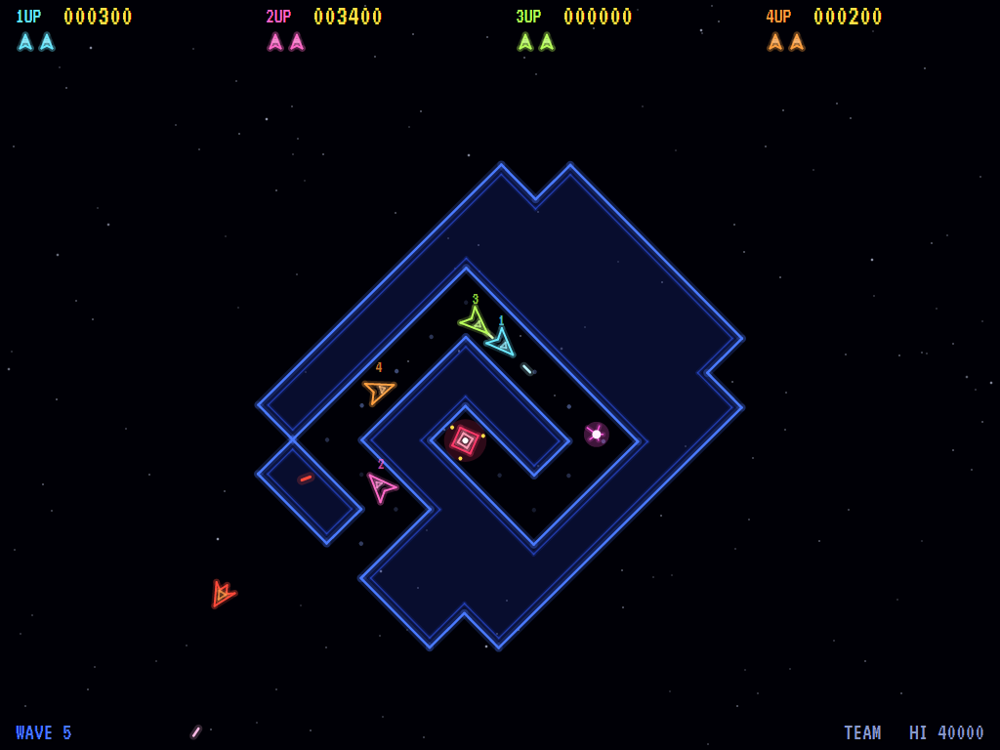
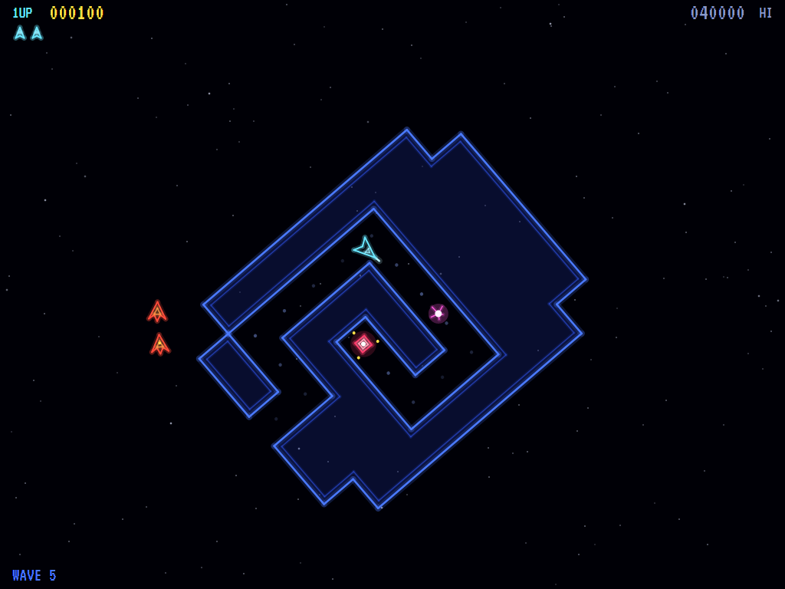
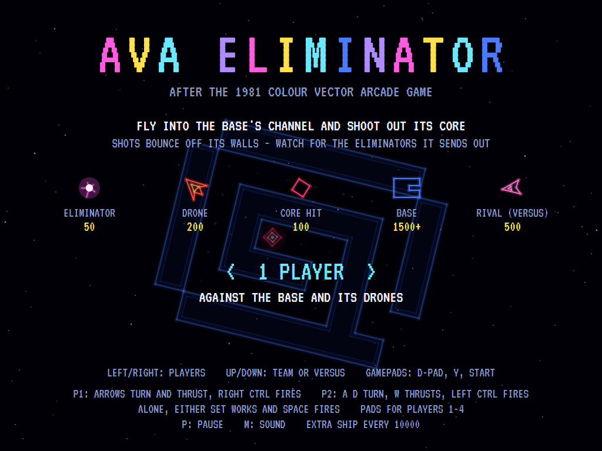
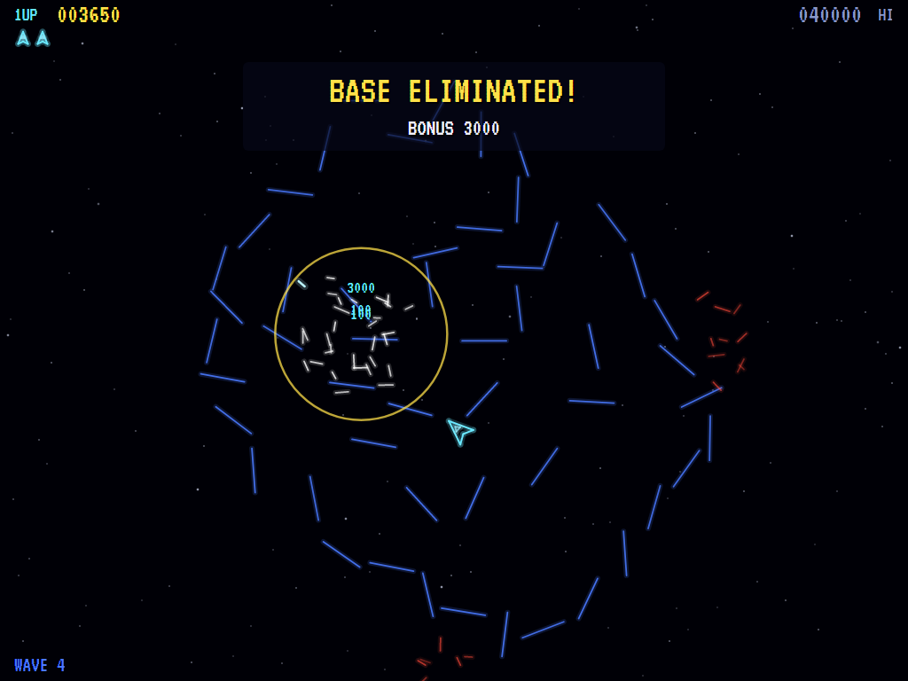

# AVA Eliminator

[](https://github.com/Harlock123/AVAEliminator/actions/workflows/build.yml)

A colour vector shooter in the style of Sega/Gremlin's 1981 arcade game **Eliminator**, built with .NET 10 and
Avalonia UI. A great glowing fortress, the Eliminator base, fills the middle of the arena. One narrow channel winds
into it from a mouth on its edge to the core, and the only way to destroy it is to fly into that channel and shoot
the core from inside. Shots bounce off its walls. The base sends its deadly eliminators out along the channel, and
drones hunt you in the open. Play alone against the computer's drones, or two to four together or against each
other, like the original's two- and four-player cabinets.

## Features

- **Rotate and thrust:** turn, thrust and fire, Asteroids-style, drifting with real momentum in an arena that wraps
  round at the edges. Up to four shots each at a time.
- **The base:** a block of a fortress built on a grid, its solid mass faintly lit and its walls drawn in glowing
  blue, with a trail of dots down the channel to the pulsing core. Ships bump off its walls unharmed; shots bounce
  off them like light off a mirror, up to four times, so a shot can glance round a corner of the channel into the
  core.
- **Eliminators:** the base spits them out one at a time. Each runs out along the channel (following it round as
  the base turns), leaves by the mouth and hunts the nearest ship, bouncing off the walls, until it burns out.
  Fly into the channel and the next comes sooner. Shoot them down for 50. Leave the base alone for 45 seconds and
  it gets angry, and they come twice as fast.
- **Drones:** red darts that come in from the edges of the screen, close on the nearest ship (round the base if it's
  in the way), circle and shoot. 200 each; one that rams you takes you with it.
- **Each base harder than the last:** six fortresses, from a straight channel to a long spiral, then round again.
  From the third wave the base turns, a little faster each wave and one way then the other; from the third wave its
  core takes two hits, then more. More drones come, quicker and better shots.
- **One to four players:**
  - **One player** against the base and its drones.
  - **Team:** two to four together. Shots pass through team-mates, and each scores for themselves.
  - **Versus:** two to four against the base and each other. Shots kill rivals, for 500, and fewer drones come.
  - Whoever shoots out the core gets the base's bonus: 1500 for the first, 500 more each wave.
  - Each player starts and comes back in a corner of their own, untouchable for a moment. The game goes on while
    anyone has a ship left.
- **Lives and points:** three ships each, an extra one every 10000; 100 for each hit on the core.
- **The attract mode** plays itself, taking turns with one player, a team of four, and two against each other: a
  computer pilot that shoots what threatens it, gets out of the way of shots, finds its way round the base to the
  mouth, creeps down the channel to the furthest point it can see, and fires as soon as it sees the core.
- **The high-score table** with initials, each player with a good enough score entering theirs in turn.
- **The sounds** are all synthesised: shots, ricochets, the eliminators' howl, the core's bong, the base going up,
  its low hum, and the tunes.

## Screenshots

| A team of four | Down the channel |
|:--------------:|:----------------:|
|  |  |
| Four players and the spiral base. | Creeping in, eliminators coming out. |

| The title | Base eliminated |
|:---------:|:---------------:|
|  |  |
| How many, and together or against each other. | The walls flying apart. |

The screenshots are made by the tests, which play the game in a real (headless) window; see
[Tests](#tests).

## Download and run

Ready-to-run builds for Windows, macOS and Linux, on both Intel/AMD and ARM, are on the
[Releases page](https://github.com/Harlock123/AVAEliminator/releases/tag/latest). **Latest build** is
rebuilt on every push to `main`. Each download is one self-contained executable: no .NET install is
needed.

| Platform | Archive |
|---|---|
| Windows | `AVAEliminator-win-x64.zip`, `AVAEliminator-win-x86.zip`, `AVAEliminator-win-arm64.zip` |
| macOS | `AVAEliminator-osx-arm64.tar.gz` (Apple silicon), `AVAEliminator-osx-x64.tar.gz` (Intel) |
| Linux | `AVAEliminator-linux-x64.tar.gz`, `AVAEliminator-linux-arm64.tar.gz`, `AVAEliminator-linux-arm.tar.gz` |

```bash
tar -xzf AVAEliminator-linux-x64.tar.gz     # or linux-arm64, linux-arm, osx-arm64, osx-x64
./AVAEliminator
```

On Windows, unzip and run `AVAEliminator.exe`. On macOS, if Gatekeeper refuses to open it, run
`xattr -d com.apple.quarantine AVAEliminator` once. Run with `--no-audio` for silence.

**Sound** comes through OpenAL Soft, built in for every platform. In a virtual machine the game
detects it and uses a larger audio buffer, so the sound doesn't break up.

**Gamepads** use SDL2, which is bundled for Windows, macOS and Intel/AMD Linux. ARM Linux builds need it
installed; without it the keyboard still works:

```bash
sudo apt install libsdl2-dev            # Debian / Ubuntu / Raspberry Pi OS
sudo pacman -S --needed sdl2-compat     # Arch / Omarchy
```

## Controls

| Action | One player | Player 1 (of two or more) | Player 2 | Gamepad (players 1 to 4) |
|---|---|---|---|---|
| Turn | Left / Right or A / D | Left / Right | A / D | Left stick / D-pad |
| Thrust | Up or W | Up | W | Up, B, left trigger or bumper |
| Fire | Space, Z, Ctrl, Shift, F or / | Right Ctrl, Right Shift, / or NumPad 0 | Left Ctrl, Left Shift or F | A, X, right trigger or bumper |

| On the title | Keyboard | Gamepad |
|---|---|---|
| Start with 1 to 4 players | 1, 2, 3 or 4 | |
| Fewer or more players | Left / Right | D-pad left / right |
| Team or versus | Up / Down, V or T | D-pad up / down, or Y |
| Start | Enter | Start |

| Anywhere | Keyboard | Gamepad |
|---|---|---|
| Pause | P or Esc | Start or Back |
| Quit (while paused) | Esc | Back |
| Sound on/off | M | |
| Screenshot | Ctrl+S (to your Pictures folder) | |

Players 3 and 4 need gamepads; gamepads go to players 1 to 4 in the order they're plugged in. On the high-score
table, type your initials, or use up/down and Space, then Enter.

## Tests

```bash
dotnet test AVAEliminator.slnx
```

The engine has no UI and runs in fixed 60 Hz steps, so it plays the same at any frame rate, and a seed
always plays the same game. The tests check:

- **The base:** every one has a single channel from a mouth on its edge to a core walled in on three sides; from
  outside the core shows only straight down the first base's channel; the walls run between solid and open in long
  runs; its frame turns there and back; a ship flying into a wall bounces off and stays outside, and one the
  turning base lands on is pushed out; a shot bounces off a wall like light off a mirror, goes down the channel into
  the core, and can glance round a corner into it; lines of sight go across the base, not round the edges of the
  arena.
- **The ships:** turning, thrust, drift and a top speed; the arena wrapping round; shots from the nose, four at a
  time; bumping the base unharmed.
- **The fight:** a shot into the core eliminates the first base for the bonus and its walls fly apart; the next wave
  brings a new, harder base and everyone back to their corners; later bases have longer channels, tougher cores, and
  turn one way then the other; shots from outside bounce off harmlessly; an eliminator runs out along the channel,
  hunts the nearest ship and burns out; it kills, and can be shot down for 50; the base fires every few seconds,
  sooner at a ship in its channel, and twice as often once angry; drones come in up to the wave's number, hunt the
  ships, are shot down for 200, take a ship that they ram, and their shots kill.
- **Lives and modes:** a ship hit comes back in its corner untouchable; the last life lost, the game is over and
  good scores enter initials, several players in turn, best first; the game goes on while anyone is left; an extra
  ship every 10000; each player has a corner facing the base; team-mates' shots pass through each other, while in
  versus they kill for 500; whoever shoots out the core gets the bonus; ships push each other apart.
- **The machine:** the title, demonstrations taking turns (one player, a team of four, two in versus) and the table;
  starting with the chosen number and mode; pause; the same game from the same seed; the computer pilot clearing
  the first waves alone, and a team of them clearing a turning base; every sound has its file; the high-score table
  kept between games.
- **The controls,** through the input handler: right turns clockwise on the screen; up thrusts the way the ship
  faces; alone, every fire key works; two players share the keyboard (the arrows and the right-hand keys for one,
  W A D and the left-hand keys for two); players 3 and 4 need gamepads; a Shift let go as Caps Lock is let go.

`tests/AVAEliminator.Tests/PilotProbe.cs` reports how the computer pilots get on over whole games, wave by wave,
for tuning (`ELIMINATOR_PROBE=1`, `1:5` to start at wave 5, `4` for a team of four, `2v` for two in versus;
`ELIMINATOR_SEEDS=1,2,3`):

```bash
ELIMINATOR_PROBE=1 dotnet test tests/AVAEliminator.Tests --filter PilotProbe --logger "console;verbosity=detailed"
```

The screenshot tests draw the real screen in a headless window. To refresh the README's pictures:

```bash
ELIMINATOR_SHOTS=$PWD/Images dotnet test tests/AVAEliminator.Tests --filter ScreenshotTests
```

## Building

```bash
dotnet build AVAEliminator.slnx
dotnet run --project src/AVAEliminator
```

Needs the .NET 10 SDK. The sounds and tunes are made by `tools/make_sounds.py` (standard-library Python):
`python3 tools/make_sounds.py` rewrites `src/AVAEliminator/Sounds`.

## Project structure

```
AVAEliminator/
├── AVAEliminator.slnx
├── src/AVAEliminator/
│   ├── Engine/
│   │   ├── GameEngine.cs        # States, the title's choices, the demonstrations, initials for each player
│   │   ├── GameEngine.Play.cs   # The ships and their shots, the base's eliminators, the drones, hits, waves
│   │   ├── Fortress.cs          # The six bases: walls, the channel and core, bouncing, lines of sight
│   │   ├── Pilot.cs             # The computer player (the demonstration, and the tests)
│   │   ├── Entities.cs          # The wrapping arena, ships, shots, drones and eliminators
│   │   ├── HighScoreTable.cs, InitialsEntry.cs
│   │   ├── InputHandler.cs, ControllerManager.cs  # The shared keyboard and four SDL2 gamepads
│   │   └── SoundManager.cs      # Effects, the hum and the tunes through OpenAL
│   ├── Audio/                   # The OpenAL engine (from the author's AVABand)
│   ├── Views/                   # The vector drawing: the base, the ships and the screens
│   └── Sounds/                  # The synthesised effects and tunes
├── tests/AVAEliminator.Tests/   # Base, gameplay, input, screenshot and probe tests
├── tools/make_sounds.py
└── Images/                      # Screenshots
```

## About and licence

AVA Eliminator © 2026 Lonnie Watson, under the [MIT License](LICENSE).

*Eliminator* © 1981 Sega/Gremlin; the name belongs to its current owner. AVA Eliminator is an independent,
unofficial game in its style. Its bases, ships, drones, graphics, sounds, tunes and code are its own; nothing is
taken from the arcade machine's program, graphics, sound or music. It is not affiliated with or endorsed by any
rights holder.

The text is drawn in [VT323](https://fonts.google.com/specimen/VT323) by Peter Hull, under the SIL Open Font
License (see `src/AVAEliminator/Assets/Fonts/VT323-OFL.txt`). Sound plays through
[OpenAL Soft](https://openal-soft.org/) (LGPL; see `src/AVAEliminator/Audio/native/COPYING-openal-soft.txt`).
